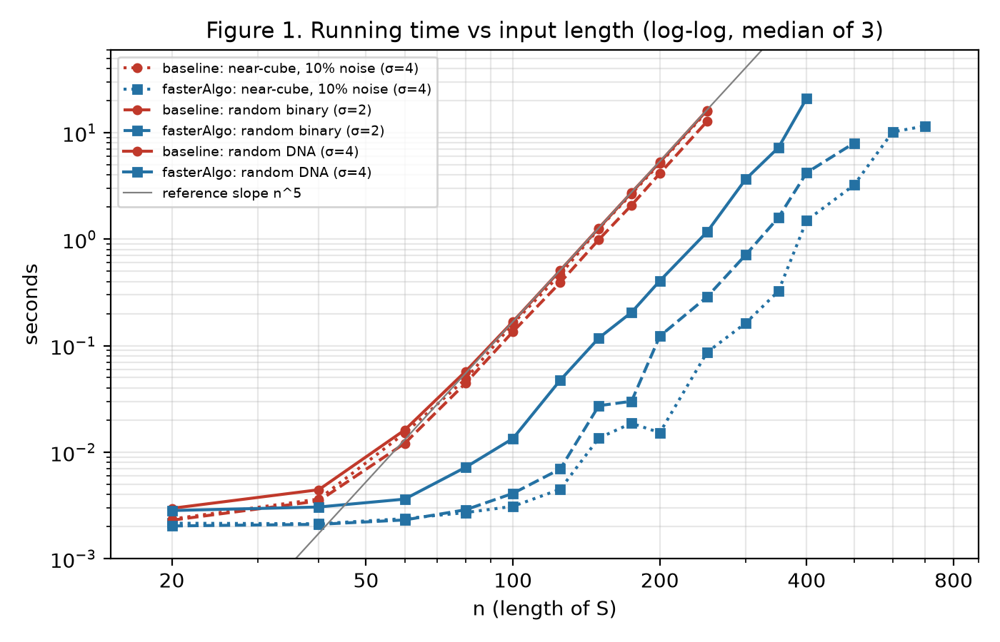

# Longest Cubic Subsequence (LCubS)

**Find the longest string X such that X·X·X appears as a subsequence of S.**
Two exact solvers in C++17, a brute-force test oracle, and a Python benchmarking pipeline.

```
S = atcgtatgcatgca   ->   X = atg,   C = atg·atg·atg   (length 9)
```

## Highlights

- **Exact O(n⁵) baseline.** It tries every way to cut S into three blocks and runs a 3-string LCS dynamic program on each cut. The total work is exactly C(n+2, 5) ≈ n⁵/120, and the measured growth exponent is 4.97 to 5.03.
- **Branch-and-bound solver, 14× to 180× faster.** Every cut is bounded by its three pairwise LCS values. The bounds for all O(n²) cuts are computed in O(n³) total time by reusing DP rows and reversing strings. Cuts are scanned best-first, and the search stops once no remaining cut can win.
- **A provable special case.** On a perfect cube S = Y·Y·Y, the faster solver runs exactly one 3-string DP, out of more than 20,000 cuts at n = 200.
- **Tested for correctness.** Both solvers match an exponential brute force on 409 random and edge-case strings. The benchmark driver also checks that the two solvers agree on every experiment instance.

## Results

| Input type | Baseline: largest n in 30 s | Faster: largest n in 30 s | Speedup at n = 250 |
|---|---|---|---|
| Random DNA (4 letters) | 250 | 400 | 14× |
| Random binary | 250 | 500 | 45× |
| Near-cube (10% noise) | 250 | 700 | 183× |



The fewer differences between S and a perfect cube, the tighter the bounds and the more cuts are skipped. On fully random strings the gain is a constant factor (the growth exponent stays near 5). More plots are in [`experiments/plots/`](experiments/plots), and the full write-up is in [`report/`](report).

## How it works

| Step | Idea | Cost |
|---|---|---|
| Cut lemma | X·X·X ⊑ S if and only if X is common to S[0,i), S[i,j) and S[j,n) for some cut i ≤ j | (basis of both solvers) |
| Letter filter | A letter seen fewer than 3 times can never be in X, so it is removed | O(n) |
| Upper bounds | LCS3(A,B,C) ≤ min(LCS(A,B), LCS(B,C), LCS(A,C)), computed for every cut | O(n³) total |
| Best-first search | Scan cuts by decreasing bound, using rolling-layer LCS3 with early abort | O(n⁵) worst case, far less in practice |
| Reconstruction | Rebuild X with a full table only for the winning cut | O(n³) |

## Project layout

| Path | What it is |
|---|---|
| `src/baseline.cpp` | Exact O(n⁵) solver |
| `src/fasterAlgo.cpp` | Exact branch-and-bound solver; prints pruning statistics to stderr |
| `src/common.hpp` | Shared input/output and 3-string LCS with reconstruction |
| `tests/brute.py` | Exponential brute-force reference (n ≤ ~16) |
| `tests/test_against_brute.py` | Randomised tests of every built solver against the brute force |
| `experiments/run.py` | Benchmarks: scaling, alphabet size, noise, bound tightness. Writes CSVs to `experiments/results/` |
| `experiments/plot.py` | Figures and summary tables, written to `experiments/plots/` |
| `report/` | Technical report |

## Build and run

Requirements: a C++17 compiler (clang++ or g++) and Python 3.

```sh
make                                     # builds bin/baseline and bin/fasterAlgo
./bin/fasterAlgo atcgtatgcatgca          # S as an argument
echo atcgtatgcatgca | ./bin/baseline     # or on stdin
make test                                # randomised tests against the brute force
```

The output has three lines: the length 3·|X|, then X, then `C = X.X.X`.
Several X can be optimal; for the example above, `atc` is also a valid answer of length 9.

## Reproducing the experiments

```sh
python3 -m venv .venv && .venv/bin/pip install matplotlib
make
.venv/bin/python experiments/run.py      # full run, about 15-25 min (--quick for a smoke test)
.venv/bin/python experiments/plot.py     # figures + experiments/plots/summary.md
```

Each data point is the median of 3 random strings, and each solver stops growing n once a run passes 30 s.
The numbers above were measured on an Apple M1 (8 GB) with Apple clang 21 at `-O2`.

---

Built for the Algorithm Design project in CMPT 360 (Fall 2026), University of Saskatchewan.
